<p align="center">
  
</p>

### About me

```python
class Andkaiz7(nn.Module):
    role     = "Front-end & AI Developer"
    frontend = ["React", "Next.js", "Tailwind"]
    ai       = ["LLM integrations", "Computer vision", "Document analysis"]
    tools    = ["Python", "FastAPI", "OpenCV"]

    def forward(self, idea):
        return self.build_web_app(idea) + self.build_ai_tool(idea)
```

### Side projects

<sub>Built on my own time, outside work. Repos are private, so ask me if you'd like a look.</sub>

| Project | What it does | Stack |
|---|---|---|
| **[Toono](https://github.com/Andkaiz7/toono-releases/releases)** | Dynamic Island for the MacBook notch: notifications, music with synced lyrics, calendar, battery, timers | Swift · SwiftUI |
| **TradeBot** | Gold H1 trading bot on Capital.com: EMA/ADX strategy, backtest and live share one signal function, Telegram alerts | Python |
| **Хэлэхийг хүссэн үг** | Anonymous letters: leave the words you never got to say | Next.js · Postgres · Claude API |

### Activity




